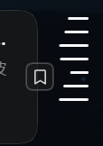
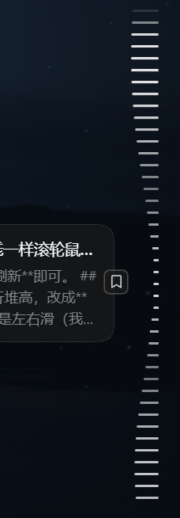

# dsh-turn-beacon · 回合书签 · 音频律动

给 [DeepSeek Harness](https://github.com/deepseek-ai) 的会话加一条**会呼吸的回合目录**：右侧那列回合刻度平时是安静的横杠，放歌时会变成随音乐起伏的水面；鼠标划过像手指点水一样荡开涟漪；收藏过的回合在波停下之后仍然比邻居更长、带主题色渐变和一个小圆点，长会话里一眼就能挑出重点。

[](https://www.npmjs.com/package/dsh-turn-beacon)
[](LICENSE)

## 功能展示

**收藏按钮就长在目录上** —— 指针停在某一格刻度上时，它的预览卡右侧出现书签按钮，按一下收藏、再按一下取消收藏：



**整列刻度随音乐起伏** —— 波不是固定循环，而是由真实音频频谱推动：



## 特性

- **真实音频分析，不是死循环**
  读取本地媒体桥的 64 段系统音频频谱（Windows 上来自 WASAPI loopback）：低频推动振幅、中频改变波长、高频决定波速，低频起音会整列「打一下」。多组不同频率的正弦叠加，波速与波长每帧都在变，所以波形自由流动、看不出循环点。
- **鼠标像手指点水**
  指针在刻度上划过时，从指针所在那一格向两侧注入涟漪（高斯扩散 + 平方衰减 + 余弦振荡），多个涟漪会叠加；离开后让最后几个涟漪自然收完再停。
- **收藏 = 长会话里的书签**
  被收藏的刻度比邻居更长、带主题色渐变与微光、末端一个小圆点；播放时跟着波一起动，停下后静置为标记态。书签按「会话 + 回合号」保存在浏览器本地，刷新和重启都还在。
- **两种表面，一个位置**
  与 Codex 一致：书签按钮在目录上，而不是挂在回答下面。
- **省电**
  只有真正在播放、或指针停在刻度上时才跑 `requestAnimationFrame`；静音静置时完全停止动画并清除内联样式。
- **尊重系统偏好**
  `prefers-reduced-motion` 下不启动动画。

## 安装

### 从 npm 安装（推荐）

```bash
dsh plugin --profile <你的 profile> add dsh-turn-beacon
```

装完后在 **插件** 页面启用 `dsh-turn-beacon`，刷新页面即可看到效果。

### 从本地目录安装

在 **插件 → 添加插件** 里选择本仓库目录，或：

```bash
dsh plugin --profile <你的 profile> add link:/path/to/dsh-turn-beacon
```

## 可选依赖：真音频频谱

真实频谱来自媒体桥的 `/wallpaper-engine/audio-spectrum`。装了
[`dsh-plugin-wallpaper-engine`](https://www.npmjs.com/package/dsh-plugin-wallpaper-engine)
（含 media-bridge）时，律动由系统音频驱动；没装、未授权或被关掉时，插件会**自动降级**为「有机漂移」——仍是活着的波，仍由播放状态门控，但不再声称在分析音频。

播放/暂停状态另有一路本地探测：Windows 走 GSMTC（系统媒体会话），页面内的 `<audio>` / `<video>` 也会被识别。

> Linux / macOS 上宿主端没有 GSMTC 探测，律动由页面媒体或降级模式驱动。

## 隐私

只读：插件读取播放状态与音频频谱，用于渲染动画。**不播放、不控制、不录制、不上传任何音频**，也不写入任何音频数据到磁盘。

## 大致原理

| 部分 | 文件 | 作用 |
| --- | --- | --- |
| Host 半 | `index.js` | 常驻读取系统媒体会话，暴露只读的 `/api/turn-beacon/media`；不涉及音频字节 |
| Client 半 | `client.js` | 拉取频谱 + 播放状态 → 每帧计算每个刻度的位移/透明度 → 写入 CSS 变量；管理书签按钮与本地存储 |
| 展示层 | `client.js` 内注入的样式表 | 只作用于回合目录（`data-tb-rail` 作用域），不修改内置组件结构 |

刻度的运动不是 CSS 关键帧动画，而是每帧按音频特征算出来的：`scaleX` 与 `opacity` 通过 `--tb-s` / `--tb-o` 写入，因此同一份波形数据既能驱动波浪，也能驱动涟漪。

## License

[MIT](LICENSE) © s17765152890-gif
